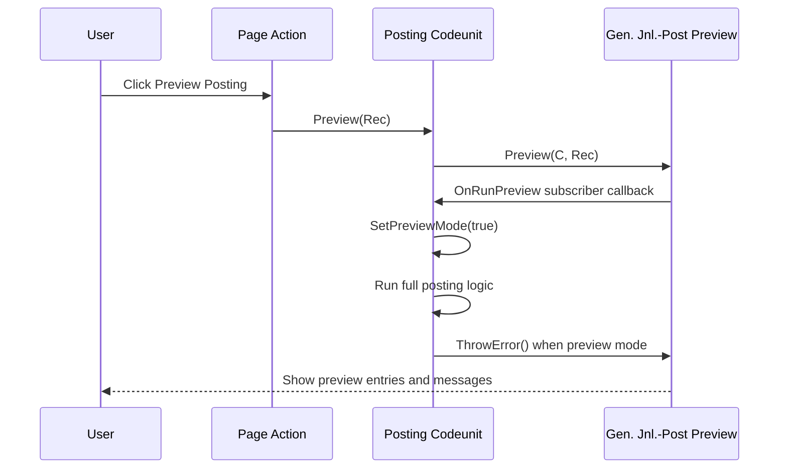

# Preview Posting

## Purpose

Provide users a **Preview Posting** action that runs full posting logic, shows expected entries, and guarantees no data is committed.

This pattern is intended for AL developers building journal/document posting flows.

## Why This Pattern

A robust preview should:

- Execute the same business logic as real posting.
- Reuse standard posting preview infrastructure (`Gen. Jnl.-Post Preview`).
- Prevent commits during preview.
- Return errors exactly as real posting would.

## Core Building Blocks

1. A posting codeunit with:
- `OnRun()` that executes full posting.
- A `PreviewMode` flag.
- A `Preview(...)` procedure.
- An `OnRunPreview` event subscriber.

2. Standard preview engine:
- Codeunit `Gen. Jnl.-Post Preview`.

3. Commit guards:
- `ThrowError()` at end of preview run to force rollback.
- Optional `[CommitBehavior(CommitBehavior::Error)]` on critical procedures.
- `SetSuppressCommit(true)` on called posting codeunits when available.

## Sequence



## Implementation Pattern

### 1. Add a page action

```al
action("Preview")
{
    Caption = 'Preview Posting';
    Image = ViewPostedOrder;

    trigger OnAction()
    var
        MyPosting: Codeunit "My Posting Codeunit";
    begin
        MyPosting.Preview(Rec);
        CurrPage.Update(false);
    end;
}
```

### 2. Add preview entry point in posting codeunit

```al
procedure Preview(var SourceLine: Record "My Source Table")
var
    GenJnlPostPreview: Codeunit "Gen. Jnl.-Post Preview";
    MyPosting: Codeunit "My Posting Codeunit";
begin
    BindSubscription(MyPosting);
    GenJnlPostPreview.Preview(MyPosting, SourceLine);
end;
```

### 3. Subscribe to `OnRunPreview`

```al
[EventSubscriber(ObjectType::Codeunit, Codeunit::"Gen. Jnl.-Post Preview", 'OnRunPreview', '', false, false)]
local procedure OnRunPreview(var Result: Boolean; Subscriber: Variant; RecVar: Variant)
var
    SourceLine: Record "My Source Table";
    MyPosting: Codeunit "My Posting Codeunit";
begin
    MyPosting := Subscriber;
    SourceLine.Copy(RecVar);
    MyPosting.SetPreviewMode(true);
    Result := MyPosting.Run(SourceLine);
end;
```

### 4. Force rollback in `OnRun`

```al
trigger OnRun()
var
    GenJnlPostPreview: Codeunit "Gen. Jnl.-Post Preview";
begin
    // Execute real posting logic
    PostAllLines(Rec);

    if PreviewMode then
        GenJnlPostPreview.ThrowError();
end;
```

### 5. Add a preview-mode setter

```al
procedure SetPreviewMode(NewPreviewMode: Boolean)
begin
    PreviewMode := NewPreviewMode;
end;
```

## Important Rules

- Keep one source of truth: preview and real posting must call the same posting procedures.
- Never branch into simplified preview logic.
- Guard all writes/commits in downstream code.
- If another posting codeunit is called, use `SetSuppressCommit(true)` when supported.
- If a procedure must never commit while previewing, use `[CommitBehavior(CommitBehavior::Error)]`.

## Reusable Skeleton

```al
codeunit 50xxx "My Posting Codeunit"
{
    EventSubscriberInstance = Manual;
    TableNo = "My Source Table";

    trigger OnRun()
    var
        GenJnlPostPreview: Codeunit "Gen. Jnl.-Post Preview";
    begin
        ExecutePosting(Rec);

        if PreviewMode then
            GenJnlPostPreview.ThrowError();
    end;

    procedure Preview(var SourceLine: Record "My Source Table")
    var
        GenJnlPostPreview: Codeunit "Gen. Jnl.-Post Preview";
        MyPosting: Codeunit "My Posting Codeunit";
    begin
        BindSubscription(MyPosting);
        GenJnlPostPreview.Preview(MyPosting, SourceLine);
    end;

    [EventSubscriber(ObjectType::Codeunit, Codeunit::"Gen. Jnl.-Post Preview", 'OnRunPreview', '', false, false)]
    local procedure OnRunPreview(var Result: Boolean; Subscriber: Variant; RecVar: Variant)
    var
        SourceLine: Record "My Source Table";
        MyPosting: Codeunit "My Posting Codeunit";
    begin
        MyPosting := Subscriber;
        SourceLine.Copy(RecVar);
        MyPosting.SetPreviewMode(true);
        Result := MyPosting.Run(SourceLine);
    end;

    local procedure ExecutePosting(var SourceLine: Record "My Source Table")
    begin
        // Shared logic for both real post and preview.
    end;

    procedure SetPreviewMode(NewPreviewMode: Boolean)
    begin
        PreviewMode := NewPreviewMode;
    end;

    var
        PreviewMode: Boolean;
}
```
