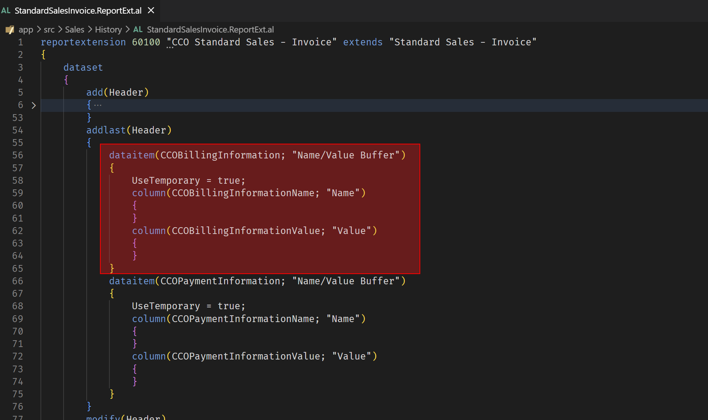
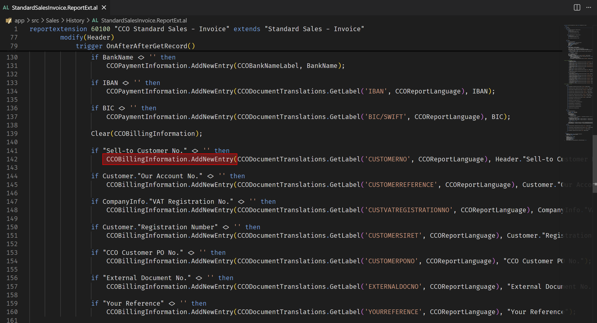
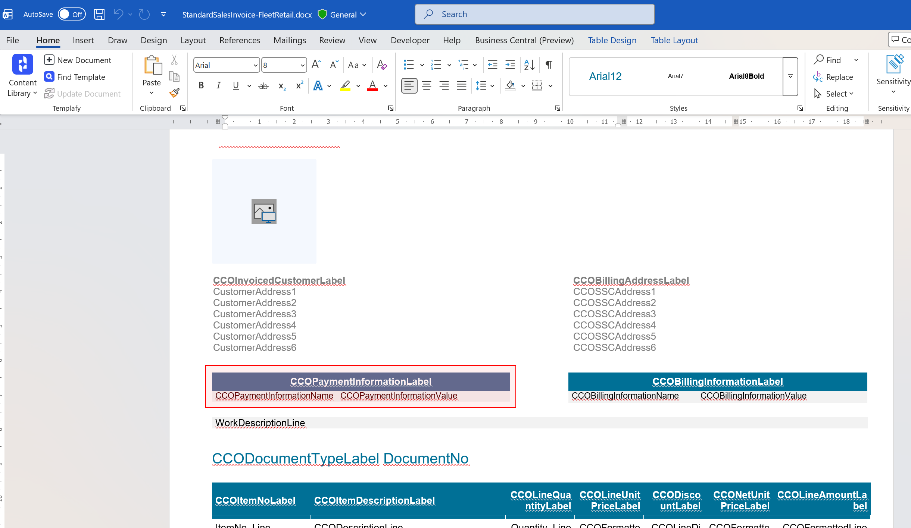
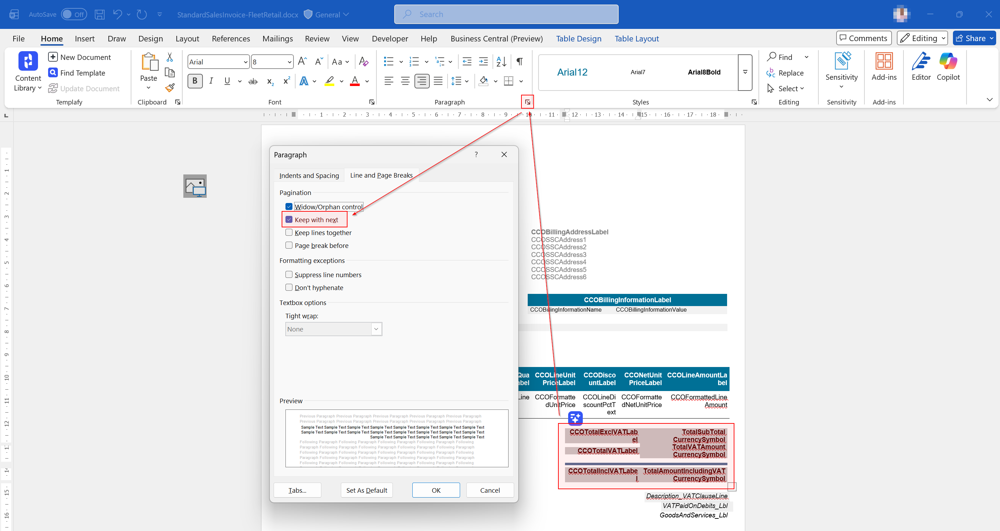
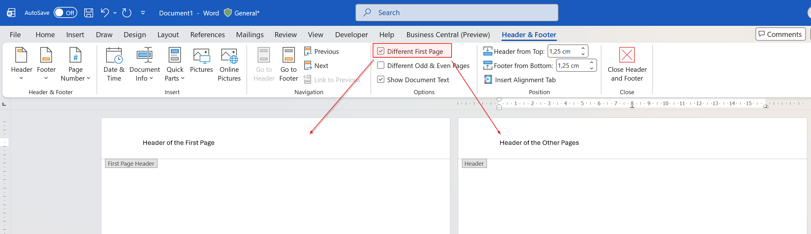
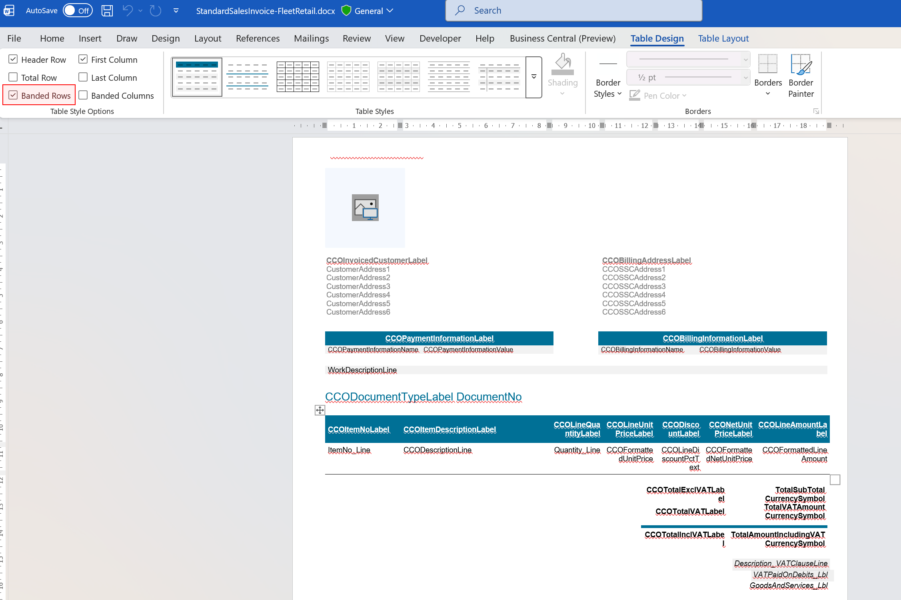
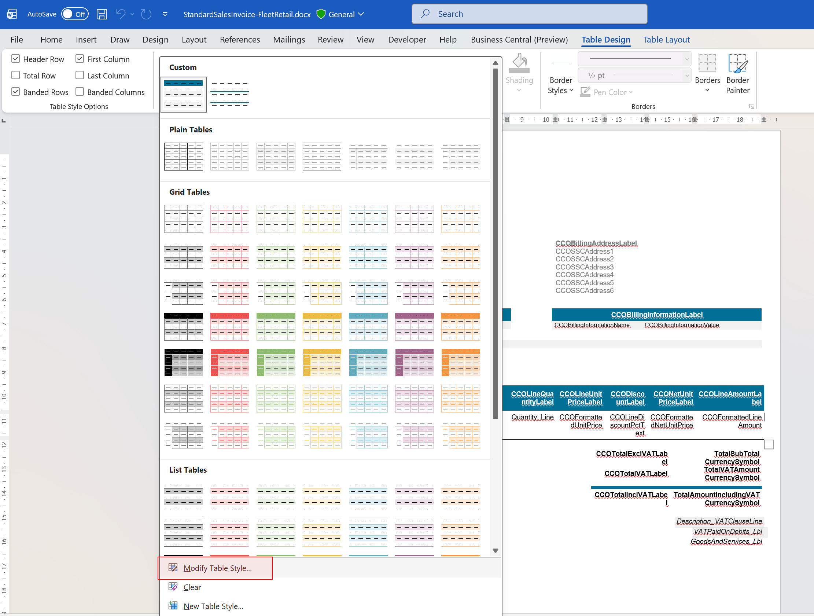
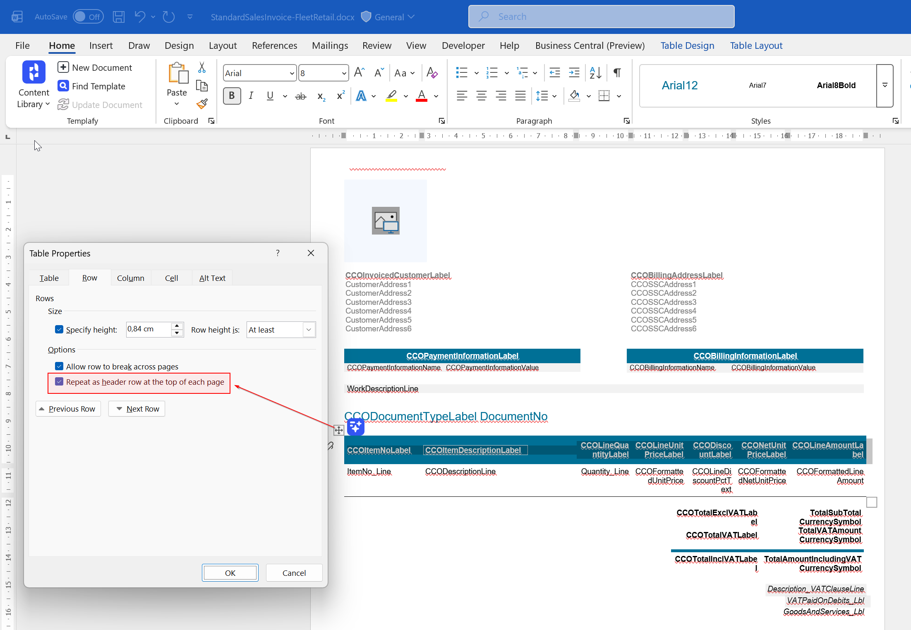

# Word Layouts

# Overview

This document provides dos and don'ts for designing word layouts in Business Central.
This document mostly leverage the existing features of Word that might be unknown to some users, but can be very helpful in designing word layouts.

# How to create a table with dynamic lines?

1. In your AL code, create a new dataitem in your report dataset. In this example, the dataitem is cased on the temporary table `Name/Value Buffer`.

    

2. Before this dataitem is emitted in the dataset, fill the temporary table with the values you want to display in your table.

    

3. Finally, in your Word layout, insert a table and with on line which will be dynamically repeated according to the number of records in your temporary table.

    

# How to keep an entire table on the same page?

1. Select the entire table by clicking the move handle at the top left corner of the table.
2. In the ribbon, click on the arrow at the bottom right of the **Paragraph** section to open the Paragraph dialog box.
3. Go to the **Line and Page Breaks** tab.
4. Make sure to check the **Keep with next** option. This will ensure that the selected table stays on the same page as the following content.

    

# How to create conditional labels?

You cannot set conditions directly on labels in Word, but you can achieve a similar effect by dynamically emitting a different label based on your conditions in AL code.

# How to handle different page headers in the same document?

You can easily distinguish a different header on the first page of your document by using the **Different First Page** option in the Header & Footer Tools Design tab. This allows you to have a unique header on the first page, while the rest of the pages can share a common header.

# How to alternate line colors in a table?

1. Select the rows of your table that you want to apply alternating colors to.
2. In the ribbon, click on the **Table Design** tab.
3. Make sure you enabled the **Banded Rows** option in the Table Styles Options group. This will apply alternating colors to the selected rows, making it easier to read and visually appealing.

    

4. You can further customize the colors used for the banded rows by selecting a different table style from the Table Styles gallery or by modifying the existing style to suit your preferences.

    

# How to repeat table headers on each page?

1. Select the header row(s) of your table that you want to repeat on each page.
2. Right-click on the selected row(s) and choose **Table Properties** from the context menu.
3. In the Table Properties dialog box, go to the **Row** tab.
4. Make sure to check the **Repeat as header row at the top of each page** option. This will ensure that the selected header row(s) are repeated at the top of each page when the table spans multiple pages.

    

# Dos and Don'ts

| Dos                                               | Don'ts                                                                                                                                                                |
| ------------------------------------------------- | --------------------------------------------------------------------------------------------------------------------------------------------------------------------- |
| Use Styles to maintain consistency in formatting. | Avoid using the Font and Paragraph formatting options directly on the content, as it can lead to inconsistent formatting and make it harder to maintain the document. |

Bugs :
Modifier la taille d’une colonne dans un tableau peut produire un crash de Word. Pas d’explications trouvées.
Inconsistance du passage body 🡪 Header/Footer : Parfois le double click fonctionne parfois seul le passage par menu/Insert/Header(Footer)/Modify fonctionne.
(BC) Update and Export Layout : Parfois un message d’erreur est déclenché, mais le layout est quand même mis à jour et téléchargé.
Pas intuitif :
Format des cellules/lignes/colonnes de tableaux disponibles uniquement depuis format du tableau.
Inconvénients :
Formatage hors styles à éviter.
Tableaux dynamiques impossibles hors repeater (conditionner affichage d’une ligne en fonction de la valeur d’une colonne).